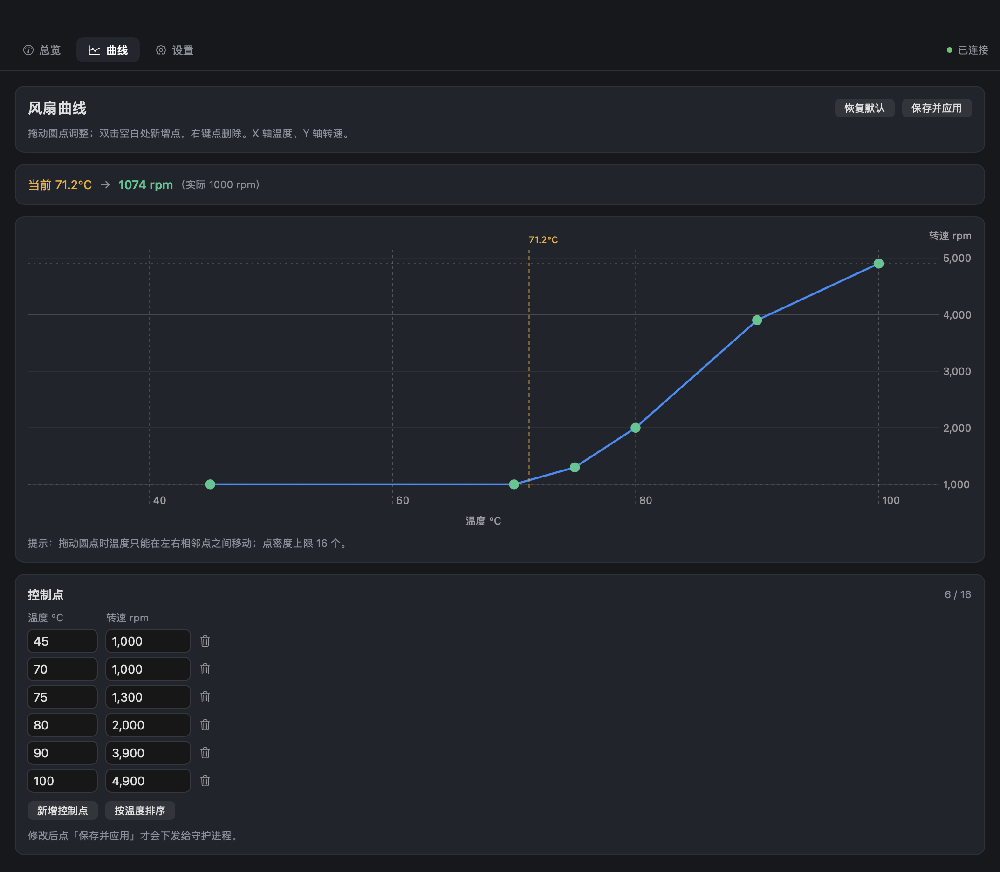
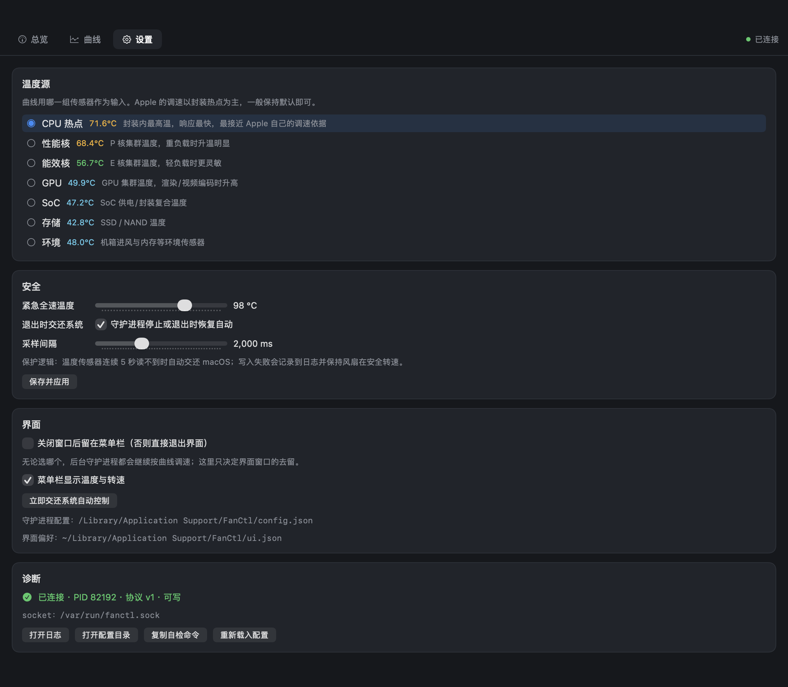
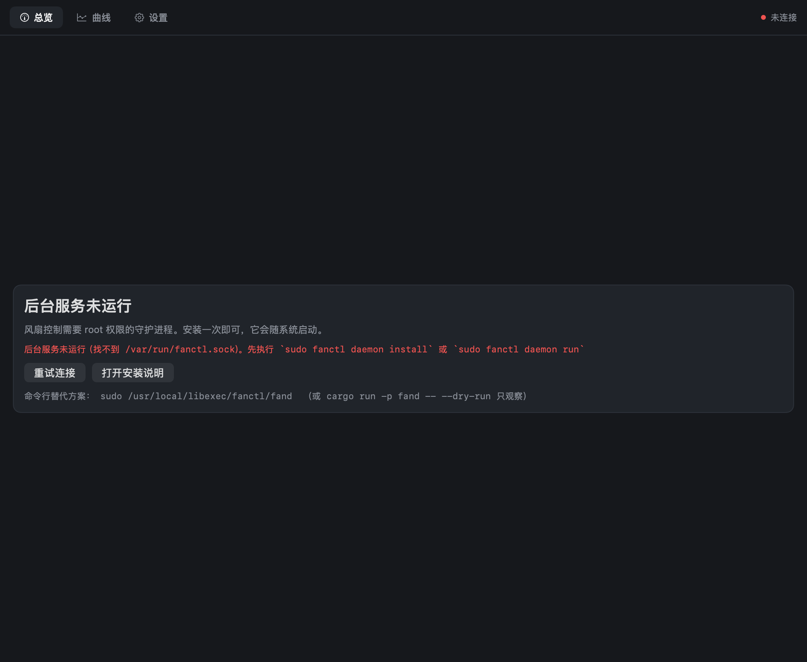

# FanCtl — Apple Silicon 风扇控制（Rust）

原生 macOS 风扇调速工具。直接读写 AppleSMC，不依赖 iStat Menus / Macs Fan  
Control，也不需要禁用 SIP 或加载内核扩展。

- **温度曲线调速**：按 CPU 热点（或你选的其他传感器组）自动升降温，可拖动编辑曲线
- **独立控制 UI**：原生窗口 + 菜单栏常驻，总览 / 曲线 / 设置三个页面
- **命令行**：`fanctl status / set / curve / auto / doctor / selftest`，方便脚本化
- **足够保守**：硬件范围钳制、转速限速、温度平滑、传感器失联自动交还 macOS、紧急全速


## 它做什么

```
┌──────────────────┐   unix socket    ┌────────────────────┐   IOKit    ┌──────────┐
│ FanCtl.app (UI)  │ ───────────────► │ fand (root daemon) │ ─────────► │ AppleSMC │
│ fanctl (CLI)     │ ◄─────────────── │  控制循环 / 安全    │ ◄───────── │ F0Ac/F0Tg│
└──────────────────┘   JSON 请求响应   └────────────────────┘   读取/写入  └──────────┘
```

读温度和读转速在普通用户下就能做；**写风扇需要 root**，所以只有一个很小的守护进程  
以 root 运行（launchd 常驻），UI 和 CLI 都通过 `/var/run/fanctl.sock` 与它通信。  
socket 属主 root、组 `admin`、权限 `0660`，普通用户连不上也不能伪造请求。

## 安装

最简单：从 [Releases](https://github.com/dxdll1394/FanCtl/releases/latest) 下载
`FanCtl-x.y.z.pkg`，双击，输密码，装完即用。一次装好 UI、守护进程、CLI 和开机启动项，
不需要终端，也不用关 SIP。

> 安装包未签名/未公证。首次打开若被 Gatekeeper 拦下，右键点击 → 打开。

自己打包：

```bash
./packaging/build_pkg.sh         # 产出 dist/FanCtl-<版本>.pkg
open dist/FanCtl-<版本>.pkg      # 双击 → 输密码 → 装完即用
```

详见 [packaging/pkg/README.md](packaging/pkg/README.md)。

从源码装（开发时用）：

```bash
cd fankit-rs
cargo build --release            # 或直接 sudo ./install.sh 一步到位

sudo ./install.sh                # 安装 CLI + 守护进程（需要管理员密码）
fanctl selftest                  # 确认写入真的生效，然后原样还原
sudo ./install.sh --app          # 顺便打包 /Applications/FanCtl.app
open -a FanCtl                   # 打开界面
```

> 界面（SwiftUI，常驻内存 ~40 MB）在 [fanui-mac](fanui-mac/)，`.pkg` 和 `--app`
> 装的都是它；旧的 egui 版保留在 `crates/fanui`，仅作回退（常驻约 220 MB）。

> 如果机器上原本装着 iStat Menus / Macs Fan Control / TG Pro 的风扇控制，  
> **先关掉它们的风扇调节**，否则两边会反复覆盖 `F0Tg`，表现是转速来回跳。  
> `fanctl doctor` 会把这些程序列出来。

不安装也能先观察（不会写入任何东西）：

```bash
cargo run -p fand -- --dry-run                 # 只读守护进程 + 终端日志
FANCTL_SOCKET=/tmp/fanctl.sock cargo run -p fanui
cargo run -p fanctl -- status                  # 直接读硬件，无需守护进程
```

## 界面


| 曲线 | 设置 |
| -- | -- |
|  |  |

守护进程没起来时界面是这副样子，不会假装一切正常：



- **总览**：当前温度 / 实际转速 / 目标转速 / 硬件范围，七组温度传感器的实时条形图，  
  控制方式切换（系统自动 / 固定转速 / 温度曲线），以及温度-转速历史曲线（支持拖动、  
  缩放、跟随最新）。
- **曲线**：拖动圆点修改曲线；双击空白加控制点、右键删点；也可以在下方的表格里  
  精确输入。旁边可调平滑时间、转速回差、最大变化速率和全速温度，右侧实时显示  
  「当前温度 → 曲线给出的转速」。
- **设置**：温度源选择（每组都带说明和当前值）、安全参数、界面行为、诊断入口。

关掉窗口后程序留在菜单栏（`LSUIElement`，不占 Dock），菜单栏实时显示  
`62° 2400`，点开可以切模式或退出。

## 命令行

```bash
fanctl status                 # 模式、转速、七组温度
fanctl status --json          # 给脚本用
fanctl set 2200               # 固定 2200 rpm
fanctl auto                   # 交还 macOS
fanctl curve --sensor cpu     # 使用 CPU 热点 + 当前曲线
fanctl curve --sensor gpu
fanctl config show            # 曲线点、平滑、回差等
fanctl config set mode=curve sensor=pcore smoothing=5 deadband=80
fanctl history --seconds 600  # JSON 行，方便喂给别的工具
fanctl doctor                 # 自检：SMC / 守护进程 / 权限 / 冲突程序
fanctl selftest               # 实机验证写入：+300 rpm 跑 5 秒再原样还原
```

## 温度从哪来

Apple Silicon 有 100 多个 SMC 温度键，FanCtl 会把它们归成七组（对应 UI 里的七行）：

| 组      | 说明          | 典型键                  |
| ------ | ----------- | -------------------- |
| CPU 热点 | 封装内最高温，响应最快 | `TCMz` `Tp3X` `Tp0f` |
| 性能核    | P 核集群       | `Tp01` `Tp0Z` `Tp1S` |
| 能效核    | E 核集群       | `Te05` `Te0A` `Te0H` |
| GPU    | GPU 集群      | `Tg0D` `Tg0L` `Tg0V` |
| SoC    | 供电/封装复合     | `TVD0` `TVV0` `TPD0` |
| 存储     | SSD / NAND  | `TH0a` `Ts0E`        |
| 环境     | 机箱进风、内存     | `Ta0p` `TPDx`        |

默认曲线用「CPU 热点」。每组取该组键的平均值作为曲线输入，换机器时会自动探测  
存在的键，不会因为键名不同而失效。查看本机实际分组：

```bash
cargo run -p fancore --example probe
```

## 调速逻辑

每一轮（默认 1 秒）：

1. 读温度，按组求平均；
2. 指数平滑（默认为 3 秒时间常数），避免单个采样点让风扇抽风；
3. 用曲线插值得到目标转速，钳制在硬件 `F0Mn`–`F0Mx` 之间；
4. 与上次目标比较：变化小于回差（默认 60 rpm）就不动；否则从速率预算里扣减着  
   靠近——预算按「最大变化速率」（默认 600 rpm/s）随时间补充，但最多攒 1.5 秒，  
   所以即使空闲很久也不会一次跳到全速；
5. 写入 `F0Md=1`（手动）与 `F0Tg`（目标转速），只在目标真的变化时才写。

安全兜底：

| 情况                 | 行为                     |
| ------------------ | ---------------------- |
| 温度 ≥ 紧急温度（默认 98°C） | **无条件全速**，忽略曲线         |
| 连续 5 次读不到温度        | 交还 macOS 自动控制，UI 提示    |
| 曲线配置损坏（点少于 2 个等）   | 交还 macOS 自动控制          |
| 守护进程退出 / 卸载        | `F0Md=0` 恢复自动（可在设置里关闭） |
| 转速请求超出硬件范围         | 钳制到 `F0Mn`–`F0Mx`      |

测试覆盖：`fancore` 29 个单元测试（插值、钳制、限速预算、回差、紧急、失联、坏配置、  
完整升温/降温轨迹），`fand` 7 个日志缓冲单测 + 12 个 socket 集成测试（模式切换、持久化、  
越界拒绝、坏请求、关闭清理、刷盘与轮转），`fanui` 2 个（中文字形完整、图表刻度）。  
`cargo test --workspace` 全绿。

## 日志

`daemon.log` 曾经是「每个转速变化写一行 + 每行 flush」，曲线模式下约 3200 次  
`write(2)`/天、约 1.2 MB/天，且只增不减。现在改成缓冲批写：

| 行为   | 说明                                                    |
| ---- | ----------------------------------------------------- |
| 缓冲刷盘 | 行先留在内存，**最多每 1800 秒落盘一次**（`log_flush_secs`）           |
| 转速合并 | 连续的转速调整折叠成一行，如 `fan 0 → 1000~1400 rpm (温度曲线, 87 次调整)` |
| 关键事件 | 模式切换、配置保存、写入失败、启动/停止**立即落盘**，不受缓冲影响                   |
| 自动轮转 | 超过 `log_max_kb`（默认 2 MB）就原地截断，保留 `.0`–`.2` 三代         |

实测量级：同样负载下从 ~20 B/s 降到 **~0.1 B/s**（约 8 KB/天），磁盘写入次数减少约两个数量级。

轮转用的是「复制→截断」而不是 rename：launchd 自己也持有该文件的追加 fd，rename 会让守护进程  
一直写进归档文件里。

调整：

```bash
fanctl config set log_flush_secs=1800 log_max_kb=2048 log_keep=3 log_coalesce=on
fanctl log              # 查看当前大小、归档与生效中的策略
fanctl log --flush      # 立刻把内存里的缓冲写盘
```

`log_flush_secs=0` 回到「每行立即写」，`log_max_kb=0` 关闭轮转。

## 安装了什么

| 文件 | 路径 |
| -------- | -------------------------------------------------- |
| 守护进程 | `/usr/local/libexec/fanctl/fand` |
| 命令行 | `/usr/local/bin/fanctl` |
| UI（App） | `/Applications/FanCtl.app` |
| launchd | `/Library/LaunchDaemons/local.fanctl.daemon.plist` |
| 配置 | `/Library/Application Support/FanCtl/config.json` |
| 日志 | `/Library/Logs/FanCtl/daemon.log` |
| socket | `/var/run/fanctl.sock` |

`.pkg` 装的就是这几样。从源码装（`./install.sh`）只装守护进程和 CLI；
加 `--app` 才会带上 `/Applications/FanCtl.app`。旧的命令行 UI
`/usr/local/bin/fanui` 已经不再安装。

卸载（会把风扇交还系统）：

```bash
sudo ./install.sh --uninstall          # 从源码装的
# 或用 .pkg 装的，直接跑  packaging/uninstall-all.sh
```

## 开发

```bash
cargo test --workspace                     # 单测
cargo run -p fancore --example probe       # 打印本机所有温度键与分组
cargo run -p fand -- --dry-run             # 只读守护进程，安全演练控制循环

./fanui-mac/build.sh                       # 编译 SwiftUI 界面
./fanui-mac/build/FanCtl.app/Contents/MacOS/FanCtl --render /tmp/shots
                                           # 离屏渲染四个页面（含离线态）
./fanui-mac/build/FanCtl.app/Contents/MacOS/FanCtl --shot /tmp/s.png --tab 1
                                           # 截真实窗口（输入框才画得对）

./packaging/build_pkg.sh                   # 打 .pkg
```

`cargo run -p fanui`（旧 egui 界面）需要同时有守护进程在跑（真实的或 `--dry-run` 的），  
界面里所有「写入」在 dry-run 下只会写日志，不会碰 SMC。

> 旧的 egui 版用 `FANCtl_SHOT` 环境变量触发截图，只用于视觉回归；它同时编译了  
> `eframe/__screenshot`，正式发布可以去掉。SwiftUI 版用 `--shot` / `--render`，
> 不需要额外 feature。

### 代码结构

```
crates/
├── fancore/   硬件与模型（无 UI 依赖）
│   ├── smc.rs          AppleSMC 的 IOKit FFI、数值编解码
│   ├── types.rs        传感器分组、曲线求值/规范化
│   ├── controller.rs   纯函数式控制逻辑（好测）
│   ├── protocol.rs     请求/响应/快照类型
│   ├── client.rs       unix socket 客户端
│   ├── config.rs       配置读写与路径
│   └── rotation.rs     历史环形缓冲
├── fand/      root 守护进程：控制循环 + socket 服务
├── fanctl/    命令行
└── fanui/     旧的 egui 界面（仅作回退，内存约 220 MB）

fanui-mac/     SwiftUI 界面（默认）.app 由 packaging/build_app.sh 打出
packaging/     .pkg 打包脚本、launchd plist、图标生成
```

## 实机验证记录

在这台 Mac mini M4 上跑过的验证（2026-10-19）：

```
$ fanctl selftest
1/3 记录当前状态：1000 rpm，模式 系统自动
2/3 请求 1300 rpm 并观察 5 秒…
    实际 1300 rpm（目标 1300），变化 300 rpm
3/3 还原为系统自动
✔ 写入链路正常：目标转速被 SMC 接受，风扇确实跟着变化。
```

真实负载（8 个 CPU 满载进程）下的曲线闭环：

| CPU 热点       | 目标转速     |
| ------------ | -------- |
| 66.8 °C      | 1767 rpm |
| 70.3 °C      | 2105 rpm |
| 73.1 °C      | 2322 rpm |
| 撤负载后 57.6 °C | 1392 rpm |

## 已知限制

- 只在 **Mac mini M4（Mac16,10，单风扇 1000–4900 rpm，macOS 27）** 上做过真机验证  
  （见上一节）。其它 Apple Silicon 靠运行时探测键名与范围，但没有实机验证。
- Rust 侧需要 macOS 12+、Rust 1.85+ 才能构建；**SwiftUI 界面要求 macOS 14+**
  （用到 `ChartProxy.plotFrame`），`.pkg` 的 `Distribution.xml` 已标注这个下限。
  Intel Mac 的 SMC 布局不同，不支持。
- `.pkg` 目前没有代码签名和公证。首次打开会被 Gatekeeper 拦一次，右键 → 打开即可。
  要给别人分发最好自己签名：`./packaging/build_pkg.sh --sign "Developer ID Installer: ..."`。
- 同时运行 fankit / Macs Fan Control / iStat / TG Pro 的风扇守护进程会互相抢控制权：  
  症状是 `F0Tg` 刚写进去就被别家改回去（`fanctl status` 里目标转速不断跳回默认值）。  
  本项目只在目标变化时写一次，所以出现这种症状基本可以断定有别的程序在周期性覆盖，  
  先退掉它。`fanctl doctor` 会提示检测到 `/var/run/fankit.sock`。
- 手动模式下 macOS 不再自动调节风扇，长时间高负载请确保曲线设置合理。
- 第一次写入需要管理员密码（安装守护进程时），之后 UI 无需再提权。
