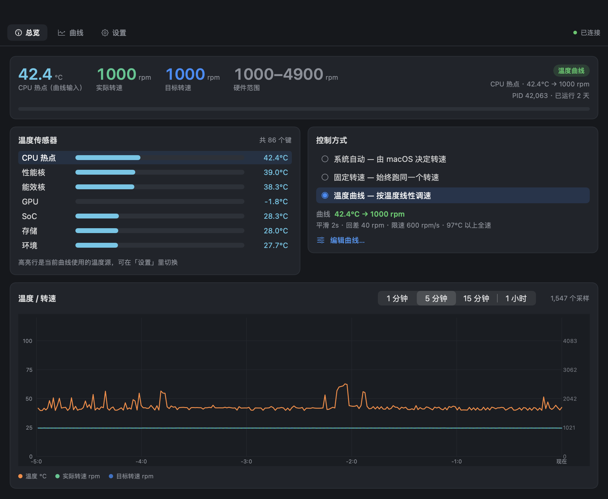

# FanCtl UI (SwiftUI)

Native macOS front end for the FanCtl daemon. Replaces the egui window with
AppKit/SwiftUI: **~37 MB resident instead of ~222 MB**, and it looks like a
macOS app because it is one.

The whole Rust side — `fand` (root daemon), `fanctl` (CLI), `fancore` — is
untouched. This UI speaks the same newline-delimited JSON protocol over
`/var/run/fanctl.sock`.



## 为什么重写

`fanui` 用的是 eframe/egui，通过 `AppleMetalOpenGLRenderer` 兼容层渲染。实测
（`footprint`，同一台机器、同样三页内容）：

| 实现 | Window 打开 | 仅菜单栏 | 二进制 |
| -- | --: | --: | --: |
| egui + glow（原 fanui） | 222 MB | — | 6.3 MB |
| egui + mmap 字体 | 175 MB | — | — |
| egui + wgpu 后端 | 182 MB | — | — |
| **本实现（SwiftUI）** | **37 MB** | 24 MB | 1.3 MB |

egui 的三块开销都不可压缩：63 MB IOSurface（5 个 12.6 MB 窗口缓冲，与窗口大小
无关）、51 MB 的 OpenGL→Metal 兼容层内存池、以及字体被 epaint 复制两份（23.5 MB
的 Hiragino Sans GB → 47 MB）。换成原生框架后这三块直接消失。

## 构建

只需要 Command Line Tools，**不需要装 Xcode**：

```bash
./build.sh                     # -> ./build/FanCtl.app
./build.sh /tmp/FanCtl.app --run
open build/FanCtl.app
```

`swiftc` 一次编译完 13 个源文件，约 5 秒，产物 1.3 MB。

## 与守护进程的协议

`fand` 期望「一行 JSON 进，一行 JSON 出」。Swift 侧用 `Encodable` 建模请求
（Rust 那边是 internally-tagged enum，所以 `"cmd": "set_mode"`），用 `Codable`
镜像 `fancore` 的数据结构：

```
Sources/Models.swift   Config / Curve / Snapshot / SensorReading …（逐字段对齐）
Sources/Client.swift   AF_UNIX socket，带超时，逐行读取
```

字段名必须与 `fancore::protocol` 完全一致，`fanctl status --json` 是最快的比对方式。

验证（会对真实守护进程做一次模式切换与配置保存，结束恢复原模式）：

```bash
./test.sh
```

```
PASS  snapshot            mode=curve temp=60.6 rpm=1000
PASS  history             515 samples
PASS  set_mode curve      已切换到温度曲线
PASS  set_config roundtrip 配置已保存
PASS  restore mode
```

## 页面

| 曲线 | 设置 |
| -- | -- |
| 曲线 | 设置 |

- **总览**：温度/实际转速/目标转速/硬件范围，七组传感器条形图（当前曲线读的那组高亮），
  控制方式切换，温度-转速历史曲线（1 分钟 / 5 分钟 / 15 分钟 / 1 小时）。
- **曲线**：拖动圆点改曲线，双击空白加点、右键删点，也可以在下方表格里精确输入；
  实时显示「当前温度 → 曲线给出的转速」。
- **设置**：温度源、紧急全速温度、采样间隔、退出时交还系统、菜单栏选项、诊断入口。

关闭窗口后程序留在菜单栏（`LSUIElement`，不占 Dock），菜单栏实时显示 `62° 1000`，
点开可以切换模式、打开日志或退出。

## 内存是怎么降下来的

三条经验，都是实测出来的：

1. **别让图表跟着 2 秒的采样节奏重绘。** Swift Charts 每个 mark 分配一个 GPU buffer，
   1 500 个采样点约 50 MB，而且每次刷新重新分配。改成 `Canvas` 后仍然是 46 MB，
   且每次重绘飙到 100 MB —— 因为**在 `Canvas` 里 `context.draw(Text)` 会每帧重新
   光栅化字形**。最后的方案是 `Shape` 画折线（Core Animation 能缓存矢量路径）
   + 普通 `Text` 做刻度标签，**稳定 37 MB，完全不波动**。
2. **历史数据本地累积，别每轮全量重拉。** 原来每 2 秒请求一次 `history(1800s)`，
   每次 1 500 条 JSON，光序列化就 30 MB 的分配量。现在启动拉一次，之后用
   snapshot 增量追加到本地。
3. **重绘频率跟数据源对齐。** 守护进程本来 2 秒采一次 SMC，UI 至少 2 秒即可。

图里 1 500 点降采样到 400 点（按桶取极值，尖峰不会丢），配合 `Shape` 已经不再
影响内存，纯粹是为了绘制速度。

## 结构

```
Sources/
  Entry.swift          入口：--render / --shot 调试模式，否则正常启动
  FanCtlApp.swift      Window + MenuBarExtra 场景
  MenuContent.swift    菜单栏下拉
  UIShell.swift        标签栏、根布局、toast
  OverviewPage.swift   总览
  CurvePage.swift      曲线编辑器
  SettingsPage.swift   设置
  HistoryChart.swift   Shape 折线图
  Models.swift         协议数据结构
  Client.swift         socket 客户端
  Store.swift          轮询、草稿、动作
  Theme.swift          配色与通用控件
  RenderMode.swift     离屏渲染（ImageRenderer）
  WindowShot.swift     真实窗口截图（cacheDisplay）
```

## 调试

```bash
# 无显示器也能出图：把三页渲染成 PNG
./build/FanCtl.app/Contents/MacOS/FanCtl --render /tmp/shots

# 抓真实窗口（AppKit 控件才画得出来），--tab 0/1/2 选页
./build/FanCtl.app/Contents/MacOS/FanCtl --shot /tmp/overview.png --tab 0

# 连 dry-run 守护进程，不碰 SMC
FANCTL_SOCKET=/tmp/fanctl.sock ./build/FanCtl.app/Contents/MacOS/FanCtl
```

`--shot` 用 `NSView.cacheDisplay` 读自己的视图树，**不需要录屏权限**。

## 已知限制

- 只支持 macOS 14+（`ChartProxy.plotFrame` 与部分 SwiftUI API）。
- 曲线页的拖拽用 `ChartOverlay` gesture；如果用 CLT 而非 Xcode 编译，
  `@State` 宏不可用（缺 `SwiftUIMacros` 插件），所以局部视图状态用了一个
  极小的 `Box<Value>` 引用包装。装了 Xcode 后可以换回 `@State`。
- 未做签名/公证；`build.sh` 只做 ad-hoc 签名，本机可用。
